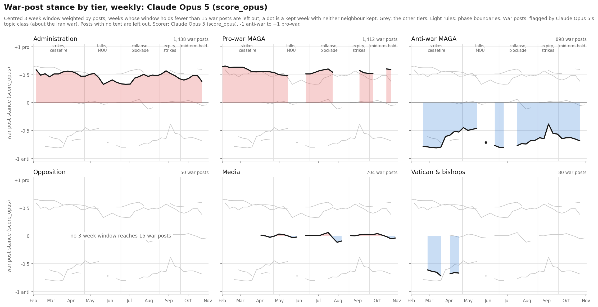
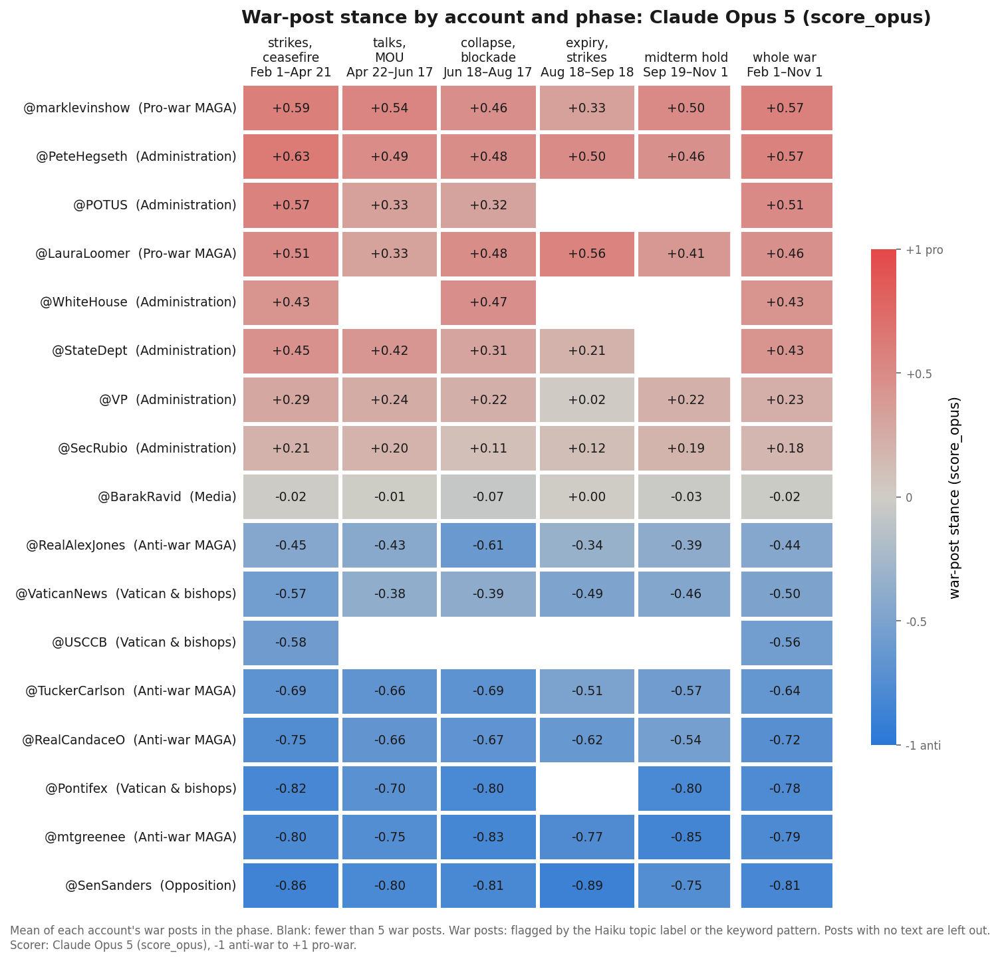

# iran-sentiment

Sentiment analysis of US political messaging during the 2026 Iran war
(Feb 1 -- Nov 1, 2026). Tracks the Trump administration, MAGA
influencers (both pro- and anti-war), the opposition, media, and the
Pope Leo XIV / Vatican moral axis across X and Truth Social, from a
month before the Feb 28 strikes through the Apr 8 ceasefire, the June
Islamabad deal and its July collapse, the renewed strikes of
September, and the hold before the Nov 3 midterms.

The analysis is frozen at the Nov 1 pull, before the midterms. X
broadcaster data runs from Feb 1 to 2026-11-01 for every account, with
the holes X's timeline endpoint left filled from its full-archive search
on Nov 3 (see *Data collection*; keyword searches are frozen at May 12);
Trump's Truth Social feed runs from Apr 4 to Oct 31, and the
replies to his eight tracked posts run to Sep 25. Nothing runs on a
schedule.

**Definitions changed on 2026-11-02.** A war post is now one that Claude
Opus 5 classes as about the Iran war, read on every post, instead of one
a keyword pattern or a Haiku label flags: that filter took in 1,527 X
posts Opus puts off the Iran war and missed 1,576 that are on it. Trump's
feed is now scored by Opus 5 like the X accounts, and the reply shares
pool 9,071 random draws instead of 1,071 (`docs/decisions.md`,
2026-11-02).

## Findings

26,298 posts from 17 X/Twitter accounts across 6 political tiers plus
4 keyword searches (a public-sentiment proxy, Feb-May only), plus 98,668 Truth Social
replies to 8 Trump posts (three from the April escalation, five from
the May-September deal-and-collapse cycle) and Trump's own Truth Social
feed from Apr 4 to Oct 31 (5,376 posts). Posts and replies with no text
to judge (fewer than 3 characters once links and a leading "RT @x: " or
"RT: " are removed: 705 X posts, nearly all bare links, 2,154 of Trump's
posts, most of them images or videos with no caption, 6,357 replies) leave
every count, share and mean below. Retweets, ReTruths and quote posts
with no words of their own count as the account's own messaging (see
*Data collection*).
Every X post with text carries VADER (lexicon baseline), RoBERTa
(`cardiffnlp/twitter-roberta-base-sentiment-latest`, valence) and a
Claude Opus 5 stance score from -1.0 (anti-war) to +1.0 (pro-war), the
last obtained by relabelling every post through the Batch API after a
teacher check showed Haiku misreading the pro-war tier (see
*Stance-model experiments*). Those collected by Sep 18 also carry
a Claude Haiku 4.5 stance score. Trump's posts with text carry the same
Opus 5 stance score (all 3,222). Every post with text from the 17
accounts (23,825) and in his feed (3,222) carries an Opus 5 topic class
that decides whether it is about the Iran war (see *Sentiment
scoring*); the keyword-search posts have none. **Stance numbers below are
the Opus score**; Haiku and RoBERTa are shown to make their
miscalibrations visible.

### Tier divergence



Weekly Opus stance of each tier's war posts, by the method of the table
below (posts with no text left out; a post is about the war when Opus's
topic class puts it on the Iran war), smoothed over a centred three-week
window weighted by posts. A week whose window holds fewer than 15 war
posts is left out, so a gap is thin data; a dot is a kept week with
neither neighbour kept. The opposition tier (one account, 50 war posts)
draws no line, and the religious tier (84) only two short stretches
before mid-April. Each panel sets one tier against the others in grey;
light rules mark the five phases. Generated Nov 3 (`visualize` writes it
as `tier_war_weekly_score_opus.png`).

Pro-war MAGA stays between +0.47 and +0.64 and anti-war MAGA between
-0.73 and -0.45: the camps never meet. They are furthest apart in the
week of Feb 16 (1.36) and about 1.32 in early March, and closest in the
week of May 11 (0.96), with the weeks of May 4 (0.98) and Apr 20 (0.99)
next. The three September weeks are 1.11 to 1.19 apart and the two
October weeks kept 1.27 and 1.29, so the camps do not draw closer late
in the war. Anti-war MAGA's step towards zero from late March to
late April is mostly a change in collection density, not in stance.
@RealAlexJones, the tier's least anti-war voice, has 20 to 25 posts a
week in February and March, where the archive fill gave him 5 per
35-hour window, and 175 to 396 a week in the three weeks from Mar 30,
which the April pulls read at 77% to 100% of X's count, so his weight
in the tier jumps. Without him the tier stays between -0.70 and -0.81 from
mid-February to mid-May. Pro-war MAGA's only gaps are the weeks of
Sep 28, Oct 5 and Oct 26, whose windows hold too few of its war posts
(see *Limitations*).

| Tier | Opus, war posts | war share | Opus, all posts | Haiku, all (collected by Sep 18) | RoBERTa, all | n |
|------|-----------:|--:|-----------:|-------------:|--------:|--:|
| maga_prowar | **+0.57** [+0.55, +0.58] | 25% | **+0.252** | -0.043 | -0.212 | 6,454 |
| admin | +0.49 [+0.47, +0.51] | 25% | +0.191 | +0.185 | +0.183 | 7,032 |
| media | +0.00 [-0.01, +0.02] | 49% | -0.058 | -0.115 | -0.044 | 2,010 |
| search (public, Feb-May) | | | -0.143 | -0.326 | -0.346 | 1,768 |
| maga_antiwar | -0.58 [-0.61, -0.55] | 22% | -0.229 | -0.210 | -0.183 | 4,991 |
| religious_authority | -0.65 [-0.71, -0.60] | 3% | -0.131 | -0.182 | **+0.311** | 2,912 |
| opposition | -0.91 [-0.93, -0.89] | 12% | -0.206 | -0.392 | -0.320 | 426 |

Feb 1 to Nov 1, posts with text. Haiku stance was not run on the Nov 1
pull or on the posts the Nov 3 archive fill added, so its column covers
the 17,347 account posts with text collected by Sep 18.

**Read the war-post column.** The stance prompt asks for a stance on the
Iran war for every post, so Opus also scores "Deport them!", "Amen" and
"THANK YOU, PRESIDENT TRUMP!" (all pro-war, from who wrote them). Most
posts are not about the war, so an all-post average is mostly those
projected scores, and it moves whenever a camp posts more or less about
the war. The war-post column keeps only posts about the war (those
Opus's topic class puts on the Iran war, see *Robustness checks*) with
95% intervals from an account-day block bootstrap.

On the war itself, the two MAGA camps are **about 1.2 points apart** on
a two-point scale (+1.15 [+1.12, +1.19]), not the 0.48 the all-post
averages show. The pro-war influencers are more hawkish than the
administration (+0.57 vs +0.49, a gap of +0.08 [+0.06, +0.11], intervals
apart under every topic definition). Anti-war MAGA (-0.58) sits a
little short of the Vatican tier (-0.65; the gap, +0.07 [+0.00, +0.13],
only just clears zero, and under the other three topic definitions it
does not) and well short of Sanders (-0.91).

### The pro-war tier was mislabelled, twice

Over all their posts, both cheap scorers put Mark Levin and Laura Loomer
on the anti-war side of zero. RoBERTa does it because their posts are
vicious in tone; Haiku does it for the same reason in weaker form,
scoring Levin's attacks on "Qatarlson" and "genocidal regimes" at -0.85
where Opus reads them as +0.60. On every post Haiku scored (those
collected by Sep 18) the two teachers agree far better everywhere
else than on this tier: 0.38 Pearson and 21%
opposite-sign labels on `maga_prowar`, against 0.63 to 0.89 and at most 5.3%
flips on admin, anti-war MAGA and religious posts. Corrected, over those
posts @marklevinshow is +0.296 and @LauraLoomer +0.165; on their war
posts they are +0.58 and +0.53, where Haiku has +0.17 and +0.13. The
pro-war influencers are hawks, full stop.

### The religious sign flip

RoBERTa reads the Vatican tier as the *most positive* tier in the
dataset (+0.311 over all posts) because faith-based language ("peace",
"mercy", "dialogue") is lexically positive. Most of that comes from the
2,828 posts not about the war, where a warm tone is no error. The tier
has only 84 war posts by Opus's topic class (53 of them @VaticanNews's);
218 of the 294 that the keyword-or-Haiku filter counted are, to Opus,
not about the Iran war. On the 84, RoBERTa sits a little below zero
(-0.07) where Opus puts them at -0.65, and 36 of them (43%) read
positive to RoBERTa and anti-war to Opus. @Pontifex is -0.291 over all
posts and **-0.84 [-0.88, -0.78] on his 16 war posts, between
@SenSanders (-0.91) and @mtgreenee (-0.76)** and measurably apart from
both (+0.07 [+0.02, +0.13] from Sanders, -0.08 [-0.13, -0.02] from
Greene). The keyword-or-Haiku filter gave him 78 war posts and the
strict Haiku topic labels 4. Of 2,912 religious-tier posts, Opus
labelled none pro-war; Haiku, which scored those collected by
Sep 18, gave eight a positive score (up to +0.75, the USCCB post below).
This tier is the reason the project moved to LLM stance scoring in the
first place.

### Who the hawks actually are

War posts only, Feb 1 -- Nov 1: @marklevinshow (+0.58) and @PeteHegseth
(+0.57) are the most pro-war accounts, then @POTUS and @LauraLoomer
(+0.53 each), @WhiteHouse (+0.51) and @StateDept (+0.46); @SecRubio
(+0.28) and @VP (+0.25) are the administration's mildest voices. At the
other end: @SenSanders (-0.91), @Pontifex (-0.84), @TuckerCarlson
(-0.78), @RealCandaceO (-0.77) and @mtgreenee (-0.76). @RealAlexJones
(-0.48) is the least anti-war of the anti-war MAGA voices and
@BarakRavid (+0.00) is neutral. @POTUS's war posts are all retweets (176
of 176) and @PeteHegseth's nearly all (554 of 600): reposting counts as
messaging here (see *Data collection*).

### Nine months: the administration went quiet more than it went soft

Opus stance of war posts by tier and phase, with the share of each
tier's posts that were about the war (keyword searches excluded; they
end May 12). The fifth phase, the midterm hold, runs from the day after
the September pull to Nov 1: no US strikes on Iran since early
September, and on Oct 8 Trump said there would be no attack before the
Nov 3 midterms, with the blockade and sanctions kept (`config/timeline.py`).

| Tier | Feb 1 -- Apr 21<br>strikes, ceasefire | Apr 22 -- Jun 17<br>talks, MOU | Jun 18 -- Aug 17<br>collapse, blockade | Aug 18 -- Sep 18<br>expiry, strikes | Sep 19 -- Nov 1<br>midterm hold |
|---|--:|--:|--:|--:|--:|
| admin | +0.51 (40%) | +0.45 (26%) | +0.46 (15%) | +0.53 (8%) | +0.43 (9%) |
| maga_prowar | +0.59 (31%) | +0.49 (18%) | +0.55 (21%) | +0.57 (11%) | +0.57 (12%) |
| media | -0.00 (61%) | +0.00 (46%) | +0.01 (45%) | +0.02 (29%) | +0.01 (30%) |
| religious_authority | -0.66 (6%) | -0.51 (2%) | -0.81 (1%) | -0.60 (1%) | -0.60 (0%) |
| maga_antiwar | -0.58 (29%) | -0.52 (17%) | -0.66 (18%) | -0.58 (15%) | -0.65 (13%) |
| opposition | -0.89 (17%) | -0.93 (6%) | -0.90 (12%) | -0.92 (11%) | -0.94 (12%) |

(`python -m src.cli phases`; intervals in
`data/processed/phases_x_tier_score_opus_opus.csv`.) The religious cells
rest on 62, 11, 8, 2 and 1 war posts.

**Read changes between columns with one caveat: the heavy accounts are
not sampled at one density.** From Sep 19, 11 accounts keep the newest
5 posts of every 35-hour window, and the Nov 3 archive fill put every
stretch since Feb 1 that the timeline had missed on the same grid (see
*Data collection*). The stretches the timeline did return keep the
density they were read at: the accounts already in the data in February
and March were read almost whole then (@marklevinshow 99% of X's own
count), the April pulls read @RealAlexJones and @BarakRavid at close to
three-quarters of it, and from May 10 to Sep 18 every 14-day slice that
hit its cap kept only its newest posts (for the heaviest, the last day
or two, with the fill's 5 a window over the rest of the fortnight).
`phases` weights every post the same, so a cell leans on its densest
stretch: @marklevinshow is 78% of pro-war MAGA's strike-phase posts and
86% of its war posts there, @RealAlexJones 51% and 65% of anti-war
MAGA's. A change from one column to another mixes these shifts
in density with real change, for the sampled accounts and for their
tiers. The 6 accounts read whole (@SenSanders, @mtgreenee,
@TuckerCarlson, @SecRubio, @Pontifex, @USCCB) are unaffected themselves,
but weigh more in their tiers where the others are sampled thinly.

- **The administration's all-post average fell from +0.26 to +0.11,
  about four-fifths of it because it stopped posting about the war.**
  War posts went from 40% of its output to 8% in September and 9% in the
  midterm hold. Splitting the -0.15 change from the strike phase to the
  midterm hold: -0.12 [-0.14, -0.10] is the smaller war share, -0.02
  [-0.04, +0.00] is softer war posts, -0.02 [-0.03, +0.00] is drift in
  its other posts. The share part is 63% of the change under the strict
  labels and a third under the keyword definition (smaller there than
  the other-post drift, -0.05 and -0.06). Its war posts softened a
  little after the strike phase (+0.51 to +0.45 in the talks and +0.46
  in the collapse, -0.06 [-0.11, -0.01] and -0.06 [-0.11, -0.00], both
  only just significant; into the collapse -0.14 to -0.15 under the
  other three topic definitions). September's +0.53 is back at the
  strike-phase level (+0.02 [-0.05, +0.08] from it) and measurably, if
  barely, above the collapse: +0.07 [+0.00, +0.13] (+0.12 [+0.00, +0.24]
  under the strict labels; the keyword pattern and the keyword-or-Haiku
  filter do not separate the two). 57 of those 69 September war posts
  are retweets. @StateDept shows the first effect: war posts fell from
  60% of its output in the strike phase to 5% (six posts) in September
  and 7% (nine) in the midterm hold, while those it did make held at
  +0.43 to +0.48 through September (+0.38 on the nine).
- **In the midterm hold the administration's war posts were the lowest
  of the war by a hair, and not measurably below any earlier phase.**
  They averaged +0.43 [+0.35, +0.51] on 68 war posts (44 of them
  retweets), against +0.45 in the talks and +0.46 in the collapse (under
  the keyword definition +0.26 against the collapse's +0.35, also the
  lowest). Against the strike phase that is -0.08 [-0.16, +0.00], not
  significant, where the keyword definition and the keyword-or-Haiku
  filter find a drop (-0.23 [-0.33, -0.13] and -0.22 [-0.32, -0.11]);
  against September it is -0.09 [-0.19, +0.00], and against the
  collapse -0.02 [-0.11, +0.06]. Under the strict labels, on 20 war
  posts, the cell is +0.50, above the collapse's +0.44, and its change
  from the strike phase, -0.10 [-0.22, +0.04], is not significant
  either. 10 of the 68 are from @WhiteHouse, and 8 from @SecRubio, read
  whole and the administration's mildest voice, against 32 of 1,003 in
  the strike phase (the caveat above). Without him the cell is +0.47
  [+0.40, +0.54], above the collapse's +0.46 without him, and its change
  from the strike phase, -0.05 [-0.13, +0.03], is not significant.
- **The pro-war influencers pulled back less.** Their war share fell
  from 31% to 11% by September and 12% in the midterm hold (13% to 4%
  and 4% under the strict labels), but the administration's fell further
  from a higher base. That is why their all-post average overtakes the
  administration's from the collapse phase on: volume, not a widening
  gap on the war itself. Their war posts dipped in the talks (+0.59 to
  +0.49, -0.09 [-0.13, -0.06]) and then held: from the strike phase to
  September the change is -0.01 [-0.07, +0.05], and the
  administration's over the same span +0.02 [-0.05, +0.08]. The
  keyword-or-Haiku filter had them easing by -0.13 each, both
  significant; the off-topic posts it took in, a growing share late in
  the war, score milder (see *Robustness checks*).
- **Pro-war MAGA stayed above the administration in the midterm hold.**
  Its war posts held at +0.57 [+0.50, +0.66] (+0.00 [-0.09, +0.10] from
  September), +0.14 [+0.04, +0.24] above the administration's (keyword
  +0.20 [+0.07, +0.32]; without @SecRubio +0.10 [+0.00, +0.21]). Under
  the strict labels, on 12 and 20 war posts, the gap is +0.14 [-0.06,
  +0.33] and not significant. Both of its accounts are sampled, so this
  cell is the 35-hour design's (68 account-days).
- **Anti-war MAGA hardened after the talks and did not measurably ease
  again; the rest of the anti-war side held.** Anti-war MAGA's war posts
  were mildest in the talks (-0.52) and hardest in the collapse (-0.66),
  -0.13 [-0.21, -0.04] from the talks. September's -0.58 [-0.68, -0.46]
  is +0.08 [-0.04, +0.21] from the collapse, not significant (the
  keyword definition and the keyword-or-Haiku filter find +0.15, both
  significant; strict +0.03 [-0.14, +0.19]), and level with the strike
  phase (+0.00 [-0.11, +0.13]). In the midterm hold they were at -0.65
  [-0.72, -0.57], level with the collapse (+0.01 [-0.09, +0.10]) and
  harder than in the talks (-0.13 [-0.22, -0.02]): the collapse and the
  midterm hold are tied for the hardest phase (-0.658 and -0.653; under
  the strict labels the midterm hold is the harder, -0.655 against
  -0.628). Who was posting changed too: @RealAlexJones, the least
  anti-war of the four, wrote 45 of the tier's 65 September war posts
  (25 of 54 in the midterm hold) while @RealCandaceO's war share fell
  from 19% to 3% (1% in the midterm hold). Jones's own war posts also
  moved (-0.44 in the talks, -0.58 in the collapse, -0.51 in September,
  -0.55 in the midterm hold), and how much of September's milder reading is composition is
  not established. The religious tier has 62 war posts in the strike
  phase (-0.66) and only 11, 8, 2 and 1 in the last four phases, too few
  to read a level from. It talked about the war less (6% of its posts in
  the strike phase, 1% by September), but that is the smaller part of
  its all-post "softening" (+0.08 [+0.04, +0.12] from the strike phase
  to the midterm hold, of which +0.03 [+0.02, +0.04] is the share and
  +0.05 [+0.02, +0.08] drift in its other posts). @SenSanders did not
  ease: his war posts went from -0.89 in the strike phase to -0.94 in
  the midterm hold, -0.05 [-0.11, -0.01].
- **Media stayed near zero.** @BarakRavid's war posts are within 0.02 of
  zero in every phase (within 0.07 under every other topic definition).

### Trump's own feed did not measurably soften

The X series above samples @POTUS at 1,239 posts, but @POTUS is the
official presidential account and all 1,239 are retweets, 1,222 of them
of @WhiteHouse. Trump's Truth Social feed is his own voice: 5,376 posts
from Apr 4 to Oct 31, 3,222 of them with text (the rest, most of them
images or videos with no caption, leave the denominator). Since Nov 2
they are scored by Opus 5 with the X tiers' prompt and model
(`teacher-check --source trump --all`, then `--merge`): all 3,222 (the
one post whose first answer could not be read was resent on Nov 3). His
war posts are the 368 that Opus's topic class puts on the Iran war. The
phases are the X phases; the fifth ends on Oct 31, with the feed.

| Phase | War posts | share of posts | all posts | war posts (n) |
|---|--:|--:|--:|--:|
| Apr 4 -- Apr 21 | +0.51 [+0.41, +0.61] | 33% | +0.173 | 90 |
| Apr 22 -- Jun 17 | +0.37 [+0.26, +0.49] | 12% | +0.070 | 88 |
| Jun 18 -- Aug 17 | +0.46 [+0.38, +0.54] | 11% | +0.075 | 101 |
| Aug 18 -- Sep 18 | +0.53 [+0.43, +0.62] | 11% | +0.074 | 57 |
| Sep 19 -- Oct 31 | +0.40 [+0.27, +0.52] | 4% | +0.026 | 32 |

(`python -m src.cli phases --source trump`.) The intervals overlap in
every phase and under every topic definition (the strict Haiku labels
put all five between +0.38 and +0.58). His war posts were mildest in the
talks phase, but that change from April, -0.135 [-0.29, +0.02], is not
significant (the two alternate Opus readings in *Robustness checks* do
find it), and the direct September-minus-April contrast is +0.025
[-0.12, +0.15] (+0.07 under the strict labels). The midterm hold,
against April, is -0.11 [-0.27, +0.04] (-0.05 [-0.22, +0.12] under the
strict labels) and against September -0.13 [-0.29, +0.01]: no measurable
change, though a drop of up to about 0.3 can't be ruled out, and under
the keyword-or-Haiku filter the drop from September is significant
(-0.16 [-0.30, -0.04]). What changed is how much he talks about it: a
third of his posts in April, 11-12% from late April to Sep 18, and 4%
in the midterm hold (32 war posts in 778), the lowest of the war. Over
all his posts, his stance moved -0.15 [-0.24, -0.07] from the strike
phase to the midterm hold, -0.13 [-0.20, -0.08] of it the smaller war
share. The administration's accounts on X also talked about the war far
less after the strike phase, but not in step with him: in the talks
phase his war share fell by nearly two-thirds (33% to 12%) and theirs by
about a third (40% to 26%), and in the midterm hold his fell to 4% while
theirs went from 8% to 9%.

**What the distilled model got wrong.** Until Nov 2 the feed was scored
by the DeBERTa model distilled from the Opus labels
(`score_opus_distilled`), checked against Opus on 400 random posts.
Against Opus on the whole feed it agrees at 0.78 Pearson (0.74 on the
368 war posts), and its war-post mean is about right on average (0.02
below Opus), but not phase by phase: it reads the collapse phase's war
posts 0.08 [0.03, 0.14] too low (+0.38 against +0.46), which turns the
talks-to-collapse change from +0.09 [-0.05, +0.22] under Opus into
-0.05 [-0.16, +0.07]. Together with the 110 posts the keyword-or-Haiku
filter took in that Opus puts off the Iran war (+0.05 on average), that
made the collapse and the midterm hold look like his mildest phases
(+0.30 and +0.29 in the table published before Nov 2), where under Opus
they are +0.46 and +0.40.

### Per-account detail



The heatmap is the war-post view by account: the mean Opus stance of
each account's war posts in each phase and over the whole war, the
numbers `phases --by user` writes, with posts with no text left out and
a cell left blank under 5 war posts. Accounts run from most pro-war to
most anti-war over the whole war; red is pro-war and blue anti-war, the
blog post's colours. Generated Nov 3 (`visualize` writes it as
`account_war_phases_score_opus.png`).

- No account other than @BarakRavid, who stays at zero (-0.00 to
  +0.02), changes side in any phase.
- The anti-war end barely moves: through Sep 18 @SenSanders,
  @mtgreenee, @RealCandaceO, @TuckerCarlson and @Pontifex stay between
  -0.69 and -0.93 in every phase they have, and in the midterm hold
  @SenSanders (-0.94 on 10 war posts), @mtgreenee (-0.76) and
  @TuckerCarlson (-0.73) stay there; @RealCandaceO has 1 war post in the
  midterm hold and @Pontifex none after the collapse. @RealAlexJones
  moves most (-0.44 in the talks, -0.58 in the collapse, -0.51 from
  Aug 18 to Sep 18, -0.55 in the midterm hold) and is the least anti-war
  of the anti-war MAGA accounts in every phase. @TuckerCarlson posts
  rarely (286 posts with text, 57 about the war, in nine months) but is
  anti-war in every phase he has (-0.73 to -0.82).
- On the pro-war side the administration's accounts soften less than
  the keyword-or-Haiku filter showed: @POTUS goes from +0.55 in the
  strike phase to +0.49 and +0.42 in the talks and the collapse, then
  +0.76 on 5 war posts from Aug 18 to Sep 18 and +0.42 on 6 in the
  midterm hold; @PeteHegseth from +0.61 to between +0.51 and +0.55
  (+0.51 in the midterm hold); @StateDept holds at +0.43 to +0.48 through
  Sep 18 and is at +0.38 on 9 in the midterm hold; @WhiteHouse, which
  now has a cell in every phase, is at +0.52, +0.43 and +0.54 through
  the collapse, +0.48 on 8 war posts from Aug 18 to Sep 18 and +0.50 on
  10 in the midterm hold. @marklevinshow is at +0.55 from Aug 18 to
  Sep 18 (26 war posts) and +0.59 in the midterm hold (22), and
  @LauraLoomer at +0.61 (22) and +0.55 (13). @SecRubio, the mildest, is
  at +0.15 on 8 in the midterm hold; @VP has too few war posts after the
  collapse for a cell.
- Over all posts (not shown), @mtgreenee (-0.323) and @Pontifex (-0.291)
  are the most anti-war accounts, with @TuckerCarlson (-0.268) and
  @RealCandaceO (-0.235) next; on war posts @SenSanders leads.
- On the posts Haiku scored (those collected by Sep 18) @SenSanders
  lands at -0.204 under Opus against -0.392 under Haiku: much of his
  output is procedural (war powers votes, hearings) and Opus reads it as
  neutral where Haiku read it as opposition.
- Blank cells are under 5 war posts: @Pontifex and @USCCB after the
  strike phase (6 and 2 war posts across the four later phases),
  @VaticanNews from the collapse on (6), @RealCandaceO and @VP from
  Aug 18 (4 and 1; 4 and 3), @TuckerCarlson from Aug 18 to Sep 18 (4)
  and @SecRubio from Aug 18 to Sep 18 (none). Since the archive fill
  every account has posts across every phase (see *Data collection*);
  how densely a cell is sampled still varies (the caveat under *Nine
  months*).

### Audience replies: eight Trump posts, April to September

Every direct reply to eight Trump Truth Social posts (98,668 replies,
95-99% of each post's reply count; 98,663 once 5 collected twice are
dropped, and the 92,306 of those with text are used below) scored with
RoBERTa and the distilled stance model, plus 9,071 random draws labelled
for stance by Claude Opus 5 (see *Population-level stance*); the 1,157
replies of the first Opus label set also carry Opus stance categories.
`event-study` still prints the table below over every reply, textless
ones included, so its figures differ.

| Post | Date | Replies | RoBERTa mean | Critical | Supportive |
|---|---|--:|--:|--:|--:|
| "Power Plant Day" rant | Apr 5 | 22,109 | -0.255 | 57% | 25% |
| "Whole civilisation will die" | Apr 7 | 15,282 | -0.387 | 64% | 18% |
| Two-week ceasefire | Apr 7 | 15,978 | -0.328 | 61% | 20% |
| "Hold off on our planned Military attack" | May 18 | 8,420 | **-0.498** | **72%** | 11% |
| "The Deal with Iran is now complete" | Jun 14 | 11,979 | **+0.200** | 34% | **52%** |
| "These fools, who think I haven't been tough enough" | Jun 18 | 3,913 | -0.428 | 68% | 15% |
| "Striking Iranian Targets near Hormuz" | Sep 1 | 4,193 | -0.273 | 58% | 23% |
| "Change the name Hormuz Strait to TRUMP STRAIT" | Sep 2 | 10,432 | -0.057 | 40% | 32% |

The stance categories below are Opus 5's (cat-v2, Nov 2): each of the
1,157 first-labelled replies read with the post it answers and filed as
`pro_war_supportive`, `pro_war_critical` (wants more force),
`pro_trump_antiwar`, `antiwar_betrayal`, `antiwar_opposition` or
`neutral_other`, then weighted back to each post's replies like the
stance shares, on the 1,071 first random draws (`reply-label report
--job cat-v2`). They replace the Haiku categories published before Nov
2, from a separate bucket-balanced sample that Haiku read without the
parent post. Read with the post, far fewer replies are anti-war: 22.5%
in some form across the eight posts against Haiku's 41.5%, and
betrayal 2.6% [1.3%, 4.1%] against 12.6% [10.2%, 15.2%].

- **Restraint was punished harder than escalation.** The May 18 post
  announcing a called-off attack is the most negative post in the
  dataset by valence, and half its replies are `pro_war_critical`
  (50.2% [40.0%, 60.5%]): people angry that Trump did not strike. The
  ceasefire post draws the same share (51.1% [42.3%, 59.9%]); no other
  post is above 27%.
- **The deal was the only thing the audience liked in tone.** June 14
  is the sole net-positive post by valence. Opus files a third of its
  replies (33%) as `pro_war_supportive`, 21% as `pro_war_critical` and
  37% as `neutral_other`; only 9.6% [5.0%, 14.5%] oppose the war
  outright, and it files none as betrayal or `pro_trump_antiwar`. On
  the stance shares below the post still leans anti-war, because the
  stance prompt counts praise for a deal against the war (the praise
  rule, see *How the reply labels are made*).
- **Renewed strikes re-consolidated the base.** The September 1 strikes
  post has the highest `pro_war_supportive` share (55% [46%, 64%]) and a
  betrayal share of 2.4%, while its population-level RoBERTa mean
  (-0.27) is close to the April "Power Plant Day" post's (-0.26).
- **The within-MAGA "betrayal" voice is small.** Opus files at most 8%
  [3%, 14%] of any post's replies as betrayal ("Whole civilisation will
  die"), 2-4% on the April rant, the hold-off, the strikes and "These
  fools" posts, and none on the ceasefire, deal and TRUMP STRAIT posts.
  Haiku, without the post and weighted the same way, had put it at 7-18%
  on seven of the eight (TRUMP STRAIT 2%).
- **The two posts added in September sit mid-range.** "These fools"
  (Jun 18), aimed at critics who say he hasn't been tough enough on
  Iran, is the second most negative by valence (-0.428), with 32%
  `pro_war_supportive`, 26% `pro_war_critical` and 3% betrayal, and the
  largest share of replies with no text (12%). "TRUMP STRAIT" (Sep 2)
  is close to neutral in tone (-0.057); Opus files 44% of its replies as
  `pro_war_supportive`, 36% as `neutral_other` and 3% as
  `pro_trump_antiwar` (Haiku 13%).

**Population-level stance.** The distilled stance model (see
*Stance-model experiments* below) scored every reply at its 256-token
training length. It was trained on broadcaster posts and reads replies
poorly: against the 1,157 replies with text that Opus labelled first
(see *How the reply labels are made*, below) it agrees at 0.58 Pearson
with 15% opposite-sign labels, and calls 63% of them pro-war where Opus
calls 49%. So the table below corrects it with 9,071 Opus-labelled
random draws: the 1,071 first draws (50 per sentiment bucket per post,
kept fixed in `data/processed/reply_sample_draws.parquet`) and 8,000
fresh draws made the same way on Nov 2 (1,000 per post, kept fixed in
`reply_sample_draws_fresh.parquet`; 7,995 labelled that day, 5 already
labelled). They are weighted back to each post's count of replies with
text, and the model's census figure is shifted by the weighted gap
between Opus and the model on them (`python -m src.cli
reply-population`, which writes
`reply_population_score_opus_distilled_v2.csv`; 95% intervals from
resampling within buckets, with a finite-population correction per
bucket). The estimand is the replies with text: the 6,357 replies with
none (an image or GIF, or one or two characters) are left out, not
imputed. `reply-population --first-draws` gives the table published
before Nov 2, on the first draws alone; the fresh draws cut the
intervals about threefold (all eight posts' anti-war share: 28%
[25%, 31%] then, 29% [28%, 30%] now).

| Post | Replies | RoBERTa valence | Model stance | **Opus-corrected stance** | Anti-war | Pro-war |
|---|--:|--:|--:|--:|--:|--:|
| "Power Plant Day" rant | 22,109 | -0.255 | +0.036 | +0.06 [+0.04, +0.08] | 33% | 38% |
| "Whole civilisation will die" | 15,282 | -0.387 | -0.011 | -0.10 [-0.12, -0.07] | **45%** | 35% |
| Two-week ceasefire | 15,978 | -0.328 | +0.195 | +0.25 [+0.22, +0.28] | 21% | 59% |
| "Hold off on our planned Military attack" | 8,420 | **-0.498** | +0.237 | **+0.41** [+0.39, +0.43] | 13% | **69%** |
| "The Deal with Iran is now complete" | 11,979 | +0.200 | +0.222 | -0.08 [-0.11, -0.05] | **46%** | 26% |
| "These fools, who think I haven't been tough enough" | 3,913 | -0.428 | +0.079 | +0.16 [+0.13, +0.18] | 13% | 38% |
| "Striking Iranian Targets near Hormuz" | 4,193 | -0.273 | +0.322 | **+0.43** [+0.41, +0.45] | 20% | 67% |
| "Change the name Hormuz Strait to TRUMP STRAIT" | 10,432 | -0.057 | +0.058 | +0.11 [+0.09, +0.12] | 16% | 47% |
| All eight | 92,306 | | +0.116 | +0.11 [+0.10, +0.12] | 29% | 45% |

- **The audience leans pro-war overall, though not on every post.**
  Across all eight posts it is 45% [44%, 46%] pro-war to 29% [28%, 30%]
  anti (mean +0.11). The other 26% take no position on the war; the
  model's own scores leave only 12% neutral and call 56% pro-war. Six of
  the eight posts have more pro-war than anti-war replies.
- **Stance and tone diverge most on May 18.** The angriest post by
  valence (-0.50) has one of the two most hawkish audiences: 69% pro-war
  to 13% anti, mean +0.41 [+0.39, +0.43], level on the mean with the
  September strikes post (+0.43 [+0.41, +0.45], 67% to 20%) and ahead of
  it on pro-war minus anti-war (56 points against 47). The base was
  furious *that Trump held off*.
- **The June deal post has more anti-war than pro-war replies, by the
  praise rule**: 46% to 26%, mean -0.08 [-0.11, -0.05]. Read against the
  post, cheering the deal counts as backing de-escalation. Without that
  rule (v2b: the same prompt without it, on the first draws) the same
  audience is 15% anti-war to 35% pro-war, mean +0.12 [+0.04, +0.21]; on
  the replies both label, the rule moves the post's mean by -0.161
  [-0.198, -0.125] and its anti-war share from 19% to 46%. Under the
  first labels, which never saw the post, the same audience came out 63%
  pro-war (see below).
- **"Civilisation will die" leans anti-war**: 45% [43%, 48%] anti to
  35% [32%, 38%] pro, mean -0.10 [-0.12, -0.07]. The NYT's "majority
  critical" reading of that post was about tone; on stance the anti-war
  share is not a majority (its interval stops at 48%).
- **Loyal repliers are more hawkish, except on the deal.** `reply-loyalty`
  gives the Opus stance of low-, medium- and high-loyalty repliers (tiers
  from each replier's bio and account age on Nov 1), design-weighted like
  the table: +0.075, +0.127 and +0.220 across the eight posts, high minus
  low +0.145 [+0.10, +0.20] (+0.125 [+0.07, +0.18] within posts). The gap
  is largest on the Power Plant Day and September strikes posts (+0.30
  [+0.16, +0.44] and +0.29 [+0.19, +0.38]) and reverses on the deal post
  (-0.14 [-0.25, -0.02]), where the praise rule counts replies that
  cheer the deal as anti-war; it also reverses on the ceasefire, within
  its interval (-0.11 [-0.26, +0.04]). The high tier holds 523 of the
  labelled draws. On the 88 among the first draws alone the gap is
  +0.073 [-0.06, +0.22], not measurable; before Nov 2 the README, on
  unweighted first-draw means, called the gradient not established.
- **"These fools" depends on the rater.** Opus 5.5, run as a second
  rater on the 1,157 first-labelled replies (`reply-label report --job
  v2-rater`), reads the 126 on this post very differently from Opus 5:
  49% anti-war against 14%, mean -0.02 against +0.10 (sample figures).
  On the other seven posts the two agree within about 6 points on both
  shares. Neither model is the reference here: the post's 13% anti-war
  above is Opus 5's reading, and Opus 5.5 would put it far higher.

**How the reply labels are made.** Opus 5 reads each sampled reply in
full together with the Trump post it answers, and is asked for the reply
author's position on the war (U.S. military action against Iran), not
the tone. A reply that only agrees with or praises the post takes the
post's position in context: praise for a ceasefire, a deal or holding
off leans against the war, praise for a strike leans for it (the praise
rule). The author's handle is left out. These labels (v2, Oct 5,
`reply-teacher-check --v2`; the fresh draws got the same prompt and
model on Nov 2) replaced a first set (v1, kept as history)
made with the broadcaster prompt, which asks for sentiment, names the
author, never showed the parent post, and saw 423 of the replies cut to
100 characters. On the same 1,157 replies the two sets agree at only
0.55 Pearson, with 17% opposite-sign pairs, and about as poorly where v1
saw the whole reply (0.56) as where it saw the cut text (0.54): the
prompt, not the cut, made the difference. A rough keyword check shows
what changed. Of the 87 replies under the ceasefire, hold-off and deal
posts that only express agreement (an assent word such as "thank",
"amen" or "great" and no word about war, peace, a deal or a strike), v1
labelled 74% pro-war and v2 9%, with 59% anti-war. Under the September
strikes post the 28 such replies stay pro-war (86% under v1, 93% under
v2). That is what moved the deal post from pro-war to anti-war. Under
the hold-off post the change runs the other way: angry replies, which v1
often scored anti-war, now read against the post as wanting the strike
(of the 19 sampled replies Haiku files as `pro_war_critical`, v1 called
26% anti-war, v2 5%), and the post's estimate went from +0.07 to +0.37
on the first draws (+0.41 with the fresh ones).

**The praise rule, measured.** v2b (Nov 2, `reply-label report --job
v2b`) is the v2 prompt without the praise rule, on the same 1,157
replies. The two agree at 0.95 Pearson with 1.7% opposite-sign pairs,
and the rule matters on two posts. On the deal post it moves the
anti-war share from 19% to 46% (above). On TRUMP STRAIT it works the
other way, praise for the post taking its hawkish position: without the
rule the corrected pro-war share on the first draws falls from 49% to
31%, and the mean moves -0.070 [-0.089, -0.051] on the paired draws.
Across all eight posts the rule moves the mean by only -0.012 [-0.022,
-0.003] and the anti-war share from 21% to 27%. Without the rule all
eight posts lean pro-war on the corrected shares. The rule stays in the
labels of record
(`docs/decisions.md`, 2026-11-02): a reply that cheers a deal does
oppose escalation.

The category shares in the first set of bullets are population figures,
weighted like the stance shares, but on the 1,071 first draws only, so
their intervals are wide. In the population table every column is a
population figure: RoBERTa valence, model stance, and the Opus-corrected
stance with its anti-war and pro-war shares. RoBERTa's blind spots are
the same as on the broadcaster data: on Haiku's categories,
`pro_war_critical` replies read as negative (-0.55) and
`pro_trump_antiwar` replies read as positive (+0.13).

## Methodology

### Data collection

- X/Twitter: v2 API, per-account JSONL caching, incremental refresh
  (each run appends only tweets newer than the latest cached one),
  capped at 500 tweets per account per run to control cost
  ($0.005/read). Through Sep 18, long gaps were walked in two-week
  slices with the cap shared evenly across slices, so a cap hit costs
  part of a fortnight rather than whole months. But a capped slice keeps
  only its newest posts: for the heaviest accounts that is the last day
  or two of each fortnight (a median of 0.7 days for @RealAlexJones, 1.6
  for @marklevinshow), and as the slices ended on the same weekday and
  hour, those blocks were 72-78% Saturday and Sunday posts. The five
  most prolific accounts were sampled at 450 for the May-September
  refresh, and eight others hit the cap in some slices too. The Nov 1
  pull (Sep 18 to Nov 1) walked each gap in 35-hour windows instead,
  whose ends move 11 hours round the clock each time (every 24 windows,
  exactly 5 weeks, end once at every clock hour and 3 or 4 times on
  every weekday). 11 accounts keep
  the newest 5 posts of every window (about 48 per 14 days, the
  May-September density, spread over every hour and weekday) and the
  other 6 are read whole (`docs/decisions.md`, 2026-10-31). The archive
  fill below put every hole on the same grid, but the stretches read
  earlier keep the density they were read at, so changes between phases
  for the sampled accounts, and for the tiers that hold them, mix shifts
  in density with real change.
- On Nov 3 the holes the timeline had left were filled from X's
  full-archive search (`x-archive fill`, `search/all`), which reaches an
  account's whole history, where the timeline stops at its latest ~3,200
  posts, and returns retweets. The fill used collect's own windows and
  rule, so the filled stretches follow the 35-hour design: each
  account's collect windows as they are, stepped back to Feb 1 in
  35-hour steps, with the newest 5 posts of each window for the 11
  sampled accounts and every post X counts for the 6 read whole. Each
  request was bounded by the ids of the posts already held, so none was
  bought twice (`docs/decisions.md`, 2026-11-02). It filled the late
  starts (nine accounts had started between Feb 21 and Apr 9; every
  account now starts on Feb 1-4), the timeline-horizon holes of May to
  July, @WhiteHouse, of which the cache had held 8% of X's Feb-Oct count
  (nothing before Apr 9, and posts in only 5 of the Nov 1 pull's 31
  windows; it now holds 10-44% of X's count every month, at 5 posts a
  window), and the collect windows that came back short or empty, among them all
  57 where X's own counts showed a failed fetch. Its 1,162 windows added
  4,744 posts (4,575 with text, 970 of them war posts), scored by VADER,
  RoBERTa and Opus 5 and given an Opus topic class like the rest (but
  no Haiku stance). X bills search/all $0.005 a post returned and
  nothing a request: 5,328 posts for $26.64, the rest of each page
  (search/all returns at least 10) kept aside, outside the analysis. The
  6 accounts read whole now hold at least 97% of X's count in every
  month.
- Retweets count as the account's own messaging (so do Trump's
  ReTruths, and his quote posts with no words of their own, which carry
  the quoted text as a ReTruth does). They are 33% of the X account
  posts (8,048 of 24,530) and 67% of the administration's; @POTUS, the
  official presidential account, posted nothing but retweets (1,239,
  1,222 of them of @WhiteHouse). The timeline returns a retweet's text
  cut to about 140 characters, and the collector does not fetch the
  original, so
  retweets are scored on that prefix (the Oct 4 re-read below left
  them as they are).
- Until Oct 4 the collector did not request X's `note_tweet` field, so
  posts over 280 characters were stored cut at 280. On Oct 4 the 2,981
  cached original posts that could have been cut were re-read by id
  (`x-backfill-text`): 2,571 were longer and now hold their full text,
  and their VADER, RoBERTa, Haiku, topic and Opus scores were redone
  from it (the old ones are archived in `*_superseded.parquet`). They
  were 22% of the war posts through Sep 18, 41% of the religious tier's
  and 35% of pro-war MAGA's (by the keyword-or-Haiku flag then in use).
  The re-read moved tier-phase war-post means by at most
  0.05 and raised war shares by up to about 2 points, as the full text
  shows more war content. New collections get the full text.
- Posts and replies with no text (fewer than 3 characters once links
  and a leading "RT @x: " or "RT: " are removed, `src/text_rules.py`)
  are not scored and leave every share and mean: 705 X posts (nearly
  all bare links), 2,154 of Trump's 5,376 Truth Social posts and 6,357
  replies.
- On Oct 6 every one of Trump's posts with no words of its own was
  re-read by id (`ts-fill-text`, free): 1,589 are images or videos with
  no caption and 231 quote one of his own earlier posts. None is a
  ReTruth whose text was dropped; the cache's 185 ReTruths have their
  text. Until then the collector ignored quotes, storing them empty or as
  Truth Social's bare "RT: <link>" fallback, and the 198 fallbacks had
  been scored on the link. A quote with no words of its own now carries
  the quoted text, as a ReTruth does, but only 10 of the 231 quoted posts
  have text: those 10 gained it and the other 221 have none. That took
  188 posts out of the denominators (2,738 with text before, 2,550 after),
  raising Trump's war shares by about 1 to 2 points; his war posts and
  their means did not change.
- Keyword searches use `/search/recent`, which only reaches back 7
  days. Searches were refreshed on Apr 16 and May 12 and not since, so
  the search tier covers Feb 1 to May 12 with a gap from roughly Apr 20
  to May 5, and is excluded from the phase comparisons above.
- Truth Social: `curl_cffi` (Cloudflare bypass). Account feeds via the
  public API with an incremental, resume-safe refresh (Trump's feed was
  last refreshed to Oct 31, anonymously); replies via the
  authenticated v2 descendants endpoint after a one-time `ts-login`
  (Truth Social's new-device security-code check).
- Window: Feb 1 -- Nov 1, 2026 for accounts (every account from Feb 1-4
  since the archive fill), frozen at the Nov 1 pull before the Nov 3
  midterms, with pre-war context events back to Jun 2025.

### Sentiment scoring

Four scorers, in order of cost:

1. VADER -- rule-based lexicon baseline. Can't distinguish "we
   destroyed their nuclear facility" (triumphant) from "destroyed"
   (negative lexical). Included to show why lexicon-based sentiment
   fails on war rhetoric.
2. RoBERTa -- `cardiffnlp/twitter-roberta-base-sentiment-latest`,
   fine-tuned on Twitter text. A valence signal, not a stance signal:
   it has a systematic positive bias on institutional language and
   sign-flips the religious tier. Batched CPU inference with memory
   checkpointing (the pipeline runs on a fanless mini PC).
3. Claude Haiku stance -- JSON-scored stance from -1.0 (anti-war) to
   +1.0 (pro-war), with an `off_topic` pre-filter. Run over every post
   collected by Sep 18; the 1,903 posts with text from the Nov 1 pull
   and the 4,575 from the Nov 3 archive fill have no Haiku score (6,478
   of the 23,825 account posts with text). Good on most tiers but reads
   angry hawkish posts as anti-war (see *Stance-model experiments*).
4. Claude Opus 5 stance -- the same prompt, verbatim, at low effort,
   over every labelled post through the Message Batches API (half
   price), and since Nov 2 over Trump's whole feed. The stance of
   record for every number in this README.

The shared prompt (`llm_prompt` in `src/analysis/sentiment.py`, also
used for Trump's feed, the Opus 5.5 second rater, the local models and
the first, v1 Opus reply labels; the current reply labels have their
own prompt, see
*Audience replies*) asks for the
*sentiment* of a post about the Iran war, names its author, and sets
the scale from "very negative/anti-war" to "very positive/pro-war". It
ties negative to anti-war in its own words, which leaves room for the
tone reading that trips Haiku on the pro-war tier.

Which posts are about the war is a separate Opus 5 call, the
stance-topic prompt (`post-label --job stance-topic` on the posts the
keyword pattern or Haiku flagged and on 1,500 random others, then
`--job stance-topic-census` on every remaining post with text, Nov 2;
the archive fill's posts went through the same two jobs on Nov 3).
It classes each post as about the Iran war, about war or peace in
general, about another conflict, or not about war, and gives a stance
of its own, used only as a check (*Robustness checks*). A post is a war
post when its class is the Iran war.

### Robustness checks

All free to rerun from the cached data and labels
(`src/analysis/inference.py`, `src/analysis/post_labels.py`); the label
jobs some of them rest on are in *Cost*:

- **What counts as a war post.** The stance prompt makes Opus score
  every post, and it gives off-topic posts a stance from the author
  (Hegseth's "It's time." +0.40, Levin's "Amen" +0.60). Four
  definitions of "about the war": Opus 5's topic class on every post
  (the stance-topic prompt, see *Sentiment scoring*; the default since
  Nov 2, 23.3% of X posts with text); a keyword pattern
  (`WAR_TOPIC_PATTERN`, loose: misses unnamed strikes, catches "culture
  war"; 21.0%); a Haiku 4.5 yes/no label on every post (`topic-label`,
  Batch API, $3.70 for 22,197 posts in September, $0.62 for 2,890 on
  Oct 4, mostly the posts re-read in full, $0.49 for 2,666 on Nov 2
  (the Nov 1 pull, Trump's 672 new posts and the 91 link shares
  resubmitted on every run), and $0.78 for 4,671 on Nov 3 (the archive
  fill's 4,575 posts with text and the 96 link shares still without a
  label); strict: drops the Pope's war appeals
  that never name Iran; posts with text it has no label for, 56 on X
  and 40 in Trump's feed, fall back to the keyword; 13.8%); and either
  of the last two (the default until Nov 2; 23.1%).
- **How far off the old default was.** The census settles it. Of the
  23,825 X posts with text, Opus puts 5,552 on the Iran war: 1,576 of
  them (28%) were flagged by neither the keyword nor Haiku, and 1,527 of
  the 5,503 the old default took (28%) are, to Opus, off the Iran war.
  Posts only the keyword caught are a third Iran-war (32.5% of 2,206);
  posts Haiku flagged nearly all are (97.4% of the 504 only Haiku
  flagged, 99.1% of the 2,793 both flagged). The 1,500 random unflagged
  posts, drawn and labelled before the census and the archive fill, put
  the missed posts at 8.9% [7.6%, 10.5%] of the unflagged ones, about
  1,637 [1,391, 1,921] of the 18,322 unflagged now; the census count
  falls inside, and so does every tier's. Missed posts are 40% of
  pro-war MAGA's war posts (528 of them @marklevinshow's), 31% of the
  administration's, 20% of anti-war MAGA's, 17% of media's, 10% of the
  religious tier's and 2% of the opposition's; off-topic posts were 74%
  of what the old default called the religious tier's war posts (218 of
  294) and 44% of the opposition's. Both errors grow as the war goes on:
  the off-topic share of the old default's war posts rises from 19% in
  the strike phase to 54% in the midterm hold, and the missed share of
  Opus's war posts from 28% to 41%. Missed posts lean the way their
  tier's flagged ones do (admin +0.44 against +0.51, pro-war MAGA +0.50
  against +0.62, anti-war MAGA -0.62 against -0.57); the off-topic ones
  the old default took are milder (admin +0.18, pro-war MAGA +0.32),
  which pulled its late-phase cells toward zero. In Trump's feed Opus
  puts 368 of the 3,222 posts with text on the Iran war; 32 were flagged
  by neither filter, 110 the old default took are off it, and 18.8% of
  the 133 only the keyword caught are on it.
- **The headline gaps hold under all four definitions.** Each keeps its
  sign and order: the MAGA war-post gap (1.08 to 1.21 over the whole
  war), pro-war MAGA above the administration with whole-war intervals
  apart, the administration's softening into the collapse (significant
  under all four, only just under the Opus class), and Trump's phase
  intervals overlapping. Anti-war MAGA is hardest in the collapse phase
  under three of them and in the midterm hold under the strict labels.
  Levels hold less well against the old default: 11 of the 30 X
  tier-phase cells move by more than 0.1 between it and the Opus class,
  up to 0.31 (the religious tier in the collapse, 44 old-default war
  posts against 8), Trump's phases by up to 0.14 and single accounts'
  whole-war means by up to 0.14 (@TuckerCarlson). Against the strict
  Haiku labels the Opus class moves none of 28 cells by more than 0.1
  (at most 0.097, pro-war MAGA in the strike phase), Trump's phases by
  up to 0.06 and single accounts by up to 0.10 (@LauraLoomer): on levels
  it sits close to the strict labels, with 68% more war posts. The
  administration's midterm-hold low is the lowest point estimate under
  the Opus class (by 0.02), the keyword pattern and the keyword-or-Haiku
  filter, not under the strict labels. Some cells are too sparse to read
  under any definition: the religious tier has 11, 8, 2 and 1 Opus war
  posts in the last four phases (7, 2, 0 and 0 strict), and @Pontifex 16
  in all (4 strict).
- **Uncertainty.** 95% intervals resample account-days within each
  account (1,000 replicates), so same-day posts move together. Each
  account keeps its total number of days, but they are drawn from its
  whole series, so its days in any one phase, and its weight within a
  tier, vary between replicates. They are sampling noise for these 17
  accounts, not a claim about accounts we did not track. Overlapping
  intervals are not a test of no change: the phase-to-phase changes
  quoted above are direct contrasts on the same replicates.
- **Shift-share decomposition.** A tier's all-post change between two
  phases splits exactly into (change in war share) x (war-post mean minus
  other-post mean), (average war share) x (change in war-post stance),
  and the same for other posts, each with its own interval.
- **Opus test-retest.** 497 posts were labelled twice by Opus 5, once
  through the direct API (the teacher check) and once in the batch
  relabel: 82% identical scores, 95% within 0.1, Pearson 0.991, no
  opposite-sign pairs (`teacher-retest`). The 82% is flattered by the
  270 pairs where both labels are exactly 0; among the rest, 61% are
  identical. Label noise is small next to every effect reported.
- **A second rater, Opus 5.5.** Claude Opus 5.5 relabelled with
  score_opus's prompt the 4,925 X and Trump posts the old default
  called war posts before the archive fill (`post-label --job rater`,
  column `score_opus55`); the fill's 1,024 new candidates have no Opus
  5.5 label, so this check rests on the posts collected before it.
  It agrees with Opus 5 at 0.97 Pearson. It reads the anti-war-leaning
  tiers milder (anti-war MAGA +0.12, opposition +0.12, religious +0.17
  on average) and the rest about the same (admin -0.03, pro-war MAGA
  -0.01, media -0.00, Trump -0.02). On the same 3,269 Opus-class X war
  posts the MAGA gap is 1.11 [1.07, 1.16] under Opus 5.5 against 1.22
  [1.17, 1.26] under Opus 5, pro-war MAGA stays above the
  administration (+0.13 against +0.11), @Pontifex stays apart from
  @SenSanders (+0.06 under both, the Opus 5.5 interval touching zero),
  and every change from the strike phase that is significant under one
  rater has the same sign under the other. Its weekly MAGA gap runs from
  0.92 to 1.39 on the weeks it covers. On Trump's flagged war posts it
  puts the talks phase measurably below April, -0.184 [-0.32, -0.03],
  where Opus 5 does not; the later phases are not measurably below
  April under either.
- **The stance-topic prompt's own score.** The prompt that gives the
  topic class also gives a stance (`score_opus_stance`). On the 4,312
  flagged posts it puts on the Iran war it agrees with score_opus at
  0.97 Pearson and runs 0.045 more pro-war on average (0.09 on pro-war
  MAGA). On all 5,552 X war posts it widens the MAGA gap in every phase
  (1.27, 1.11, 1.28, 1.24 and 1.31, against 1.17, 1.02, 1.21, 1.15 and
  1.23 on score_opus) and keeps pro-war MAGA above the administration
  in the midterm hold (+0.177 [+0.08, +0.28]). Like Opus 5.5, it puts
  Trump's talks phase measurably below April (-0.185 [-0.33, -0.04]) and
  none of his later phases.
- **Hiding the author's handle.** Both stance prompts name the post's
  author. The stance-topic prompt was rerun without the handle on a
  paired subsample of 1,957 posts drawn before the archive fill
  (`post-label --job stance-topic-nohandle`). On the 1,335 pairs both
  runs put on the Iran war, hiding the handle moves pro-war MAGA -0.107
  [-0.129, -0.085] and
  the administration -0.063 [-0.078, -0.048], anti-war MAGA +0.070
  [+0.052, +0.088], the religious tier +0.044 [+0.024, +0.063] and the
  opposition +0.028 [+0.008, +0.049], all toward zero, and media +0.044
  [+0.021, +0.066], away from it. The MAGA gap shrinks from 1.299
  [1.245, 1.349] to 1.122 [1.058, 1.182], a change of -0.177 [-0.207,
  -0.150] (14%); against score_opus on the same posts (1.234) the drop
  is -0.113 [-0.144, -0.085] (9%). Some of the camps' distance is the
  reader knowing who wrote the post; most of it survives without the
  name.
- **Reply population shares** are corrected against Opus labels (made
  from the full reply and the post it answers) on a random,
  bucket-stratified sample of 9,071 replies with text, with v2b (no
  praise rule) beside them, Opus 5.5 as a second rater on 1,157 of them
  and Opus categories read with the post (see *Audience replies*). Opus
  5.5 agrees with the v2 labels at 0.94 Pearson (mean absolute
  difference 0.11, 43 opposite-sign pairs on 1,157 replies) and reads
  30% of them anti-war against 24%, with by far the largest difference
  on "These fools".

### Event overlay

138 events are catalogued in `config/timeline.py` (military strikes,
diplomatic moments, polling, media events) and overlaid on time-series
plots. The first 36 cover the pre-war build-up through Apr 15; 48 more,
added Sep 2026 from a web-research pass with independent fact-checking,
cover May 12 -- Sep 15 (the Islamabad MOU of Jun 17, its collapse Jul 8,
expiry Aug 17, and the renewed strikes of September); 54 more, added
Nov 2026 the same way, cover Sep 17 -- Oct 31 (the midterm hold,
including Trump's Oct 8 pledge of no attack before the midterms). Each
event carries an importance score; `EVENT_LABEL_MIN_IMPORTANCE` in
settings controls which get labelled on plots. Source URLs for the new
events are in `docs/timeline_candidates_2026-05-12_to_2026-09-15.json`
and `docs/timeline_candidates_2026-09-16_to_2026-10-31.json`. Both data
layers run to Oct 31 or later, so every event is plotted.

## Stance-model experiments (GPU, Sep 2026)

Can the per-post Haiku call be replaced by something that runs free on
the homelab's RTX 3080? Three one-shot Kubernetes Jobs (`k8s/README.md`),
all evaluated on the same per-tier held-out split against the Haiku
labels the dataset carries:

| Candidate | Pearson | MAE | Sign agreement | Sign flips |
|---|--:|--:|--:|--:|
| RoBERTa valence (`score_transformer`, the current quick-look scorer) | 0.28 | 0.45 | 38% | 14.9% |
| Qwen2.5-7B-Instruct, 4-bit, same prompt as Haiku (920 posts) | 0.47 | 0.38 | 49% | 9.7% |
| Qwen3-8B, 4-bit, thinking off, same prompt (920 posts) | 0.48 | 0.38 | 63% | 8.8% |
| Qwen3-8B, 4-bit, thinking on, 1,024-token budget (363 of 399 posts parsed) | 0.59 | 0.32 | 68% | 5.2% |
| RoBERTa-large fine-tuned on the Haiku labels (3,893 posts) | 0.75 | 0.15 | 78% | 4.9% |
| DeBERTa-v3-large fine-tuned on the Haiku labels (3,893 posts) | 0.79 | 0.14 | 78% | 4.1% |
| **DeBERTa-v3-large fine-tuned on the Opus labels** (3,881 posts, vs Opus) | **0.88** | **0.11** | 78% | **2.1%** |
| Full recipe sweep on the Opus labels: six RoBERTa variants 0.81 to 0.87, DeBERTa at 256 tokens **0.869** (SD 0.011 over 5 folds) | | | | |

The distilled encoder is the clear winner: 7.5 minutes of training, then
all 98,668 replies in about 20 minutes. A recipe sweep put six RoBERTa variants between 0.71 and 0.75
Pearson, and DeBERTa-v3-large (fit with 8-bit AdamW and gradient
checkpointing to fit the 10 GB card) at 0.79. The winner cross-validates
at **0.79 Pearson (SD 0.003 over 5 folds)** with 78% sign agreement and
4.5% flips. Architecture bought four points; the rest of the gap to a
perfect reproduction is the labels' own noise (Haiku agrees with Opus 5 at
only 0.64), which is what the Opus relabel below addresses. It is strongest exactly where the valence
model failed, 0.90 Pearson and 0.4% flips on the religious tier. The
open 7B/8B models with the Claude prompt are only modestly better than
valence and not a Haiku substitute; the 2025 generation (Qwen3) fixes
many sign errors (63% agreement vs 49%) but its correlation with the
teacher is unchanged, and it is weakest on the admin tier (0.18).
Letting it reason first lifts it to 0.59 with 5% flips, at a price:
9% of answers never reached JSON inside the token budget and 399 posts
took 2.6 hours, so it is neither accurate enough to replace the
distilled model nor fast enough to score 83,000 replies.

**The relabel.** Every labelled post was re-scored by Claude Opus 5
through the Batch API (19,452 of 19,457 parsed after one resubmit, about $31). Retrained on
those labels, the same DeBERTa recipe reproduces its teacher at 0.88
Pearson with 2.1% flips, against 0.79 and 4.1% on Haiku's: the Opus
labels are simply more self-consistent, so the "ceiling is the labels"
diagnosis was right. Per tier the Opus-taught model reaches 0.90 on
admin, 0.91 on religious and 0.82 on the pro-war tier where the
Haiku-taught one had its second-weakest result. On the same held-out
rows, RoBERTa valence agrees with Opus stance at 0.06 Pearson, which is
to say not at all. Rerunning the whole recipe sweep on the Opus labels moved every recipe
up by about a tenth and kept DeBERTa-v3-large on top, though not the
order within it or among the RoBERTa variants. The 256-token recipe
scored 0.8757 against 0.8712 at 128 tokens, a margin of 0.0045, smaller
than the 0.0051 between two runs of the identical 128-token recipe
(0.8712 and 0.8763), so the two are a tie; the 256-token fit cross-validates at
0.869 (SD 0.011 over 5 folds) with 2.4% flips. Its full-label fit is
`data/models/stance_distilled_final_score_opus/`, the reply scorer of
record (`score_opus_distilled`), run at its 256-token training length.
In October the posts re-read in full (see *Data collection*) were
relabelled by Opus from their full text; the distilled model was not
retrained, so it learned those posts from their cut text.

**Mixing replies into the training set did not help.** This test used
the first (v1) reply labels: no parent post, and long replies cut to
100 characters (see *Audience replies*). The model has not been
retrained on the v2 labels; only the last comparison below has been
rechecked against them. The same recipe retrained with the 958 Opus-labelled
replies added (767 in training, 191 held out: 20% within each post, so every post is on both sides)
reproduces Opus at 0.874 Pearson with 2.2% flips on the 3,881 held-out
posts, against 0.876 and 2.1% for the posts-only model on the same posts
(0.861 on the combined holdout with the replies). On the held-out replies it
lands at 0.71 Pearson and 64% sign agreement with about 10% flips per
post, which is about what the posts-only model scores on the same kind
of rows (0.72 / 66% on all of them). Reply stance is harder than
post stance for both students -- short, sarcastic, addressed to Trump
rather than about the war -- and a few hundred extra labels do not move
it. Scored over all 98,668 replies the two models agree at 0.89 Pearson
and 73% on sign, and no post's model mean moves by more than 0.06. On the two posts added in
September, whose replies neither model had seen, the mixed model does a
little better against v1 (0.66 vs 0.60 Pearson, 11% vs 14% flips on 267
Opus-labelled replies), but the 95% interval on the gap runs from -0.01
to +0.12: a lean, not a reason to switch. Against the v2 labels on the
same 267 replies the order flips: the posts-only model reaches 0.61
Pearson with 5% flips, the mixed model 0.55 and 7%, and the interval on
the gap (-0.15 to +0.04) again crosses zero. `score_mixed_distilled` is
kept as a column for comparison; `score_opus_distilled` remains the
scorer of record.

**A reply scorer that sees the parent post (2026-10-07).** Against the v2
labels the scorer of record reaches 0.58 Pearson on the 1,157 labelled
replies, but only 0.32 on ceasefire and 0.14 on the June deal: the v2
labels read a reply against the post it answers, and the scorer never
sees that post. `reply-distill --lopo` fine-tuned the published model on
the v2 reply labels, either on the reply alone or on the reply paired with
its Trump post, holding each post out in turn (8 posts, 2 seeds, about an
hour on the 3080). On the held-out posts:

| Post | Scorer of record | Reply only | Reply + post |
|---|---|---|---|
| All 1,157 (pooled) | 0.58 | 0.63 | 0.64 (seeds 0.63-0.65) |
| June deal | 0.14 | 0.38 | 0.62 |
| Ceasefire | 0.32 | 0.55 | 0.70 |
| Hold-off | 0.54 | 0.72 | 0.76 |
| Civilisation | 0.74 | 0.64 | 0.72 |
| Power plant | 0.72 | 0.68 | 0.58 |
| September strikes | 0.77 | 0.65 | 0.70 |
| These fools | 0.52 | 0.75 | 0.58 |
| Hormuz | 0.74 | 0.73 | 0.76 |

Seeing the post fixes the posts where context decides the stance and
costs a little on the plainly hawkish ones; the sign-flip rate stays at
15%. It did not replace the scorer of record. The audience shares are
already unbiased: the Opus correction removes each post's offset, so a
better scorer only narrows the intervals. Measured on the same held-out
predictions, a cross-fitted context scorer would narrow the mean intervals
for the June deal (by about a third), ceasefire (a quarter) and the
hold-off post (a sixth), widen those for the strikes, civilisation and
power-plant posts by a tenth to a fifth, and barely move the pro and anti
shares. That gain did not justify a scorer whose eight per-post fits
aren't kept. The results are in `data/models/reply_ctx_lopo/`.

**The reply scores came from an overwritten fit (fixed 2026-09-30).**
`distill --fit-all` and the sweep's final fit both wrote to
`stance_distilled_final_score_opus/`. The replies were scored with the
128-token `distill-opus` fit hours before the sweep's 256-token fit
replaced it in place, so the reply column no longer matched the model
on disk: 0.915 correlation on replies too short to truncate, where any
rerun of the current model reproduces exactly. All 98,668 replies and
Trump's feed are now scored by the current model at its training
length (Trump's stance of record has been Opus 5 since Nov 2); the old
scores are kept as `score_opus_distilled_v0`. The two
fits are about as good against Opus on the 958 older labelled replies
(0.72 vs 0.71 Pearson, v1 labels), and the corrected reply shares, then
weighted by the v1 labels, moved by up to 5 points, inside their
intervals. Scoring at 128 rather than 256 tokens
on its own changes nothing that matters (Trump's phase means by 0.01 at
most). A final model dir is now never overwritten, and scoring reads the
training length from the model's `recipe.txt`.

**Why the teacher had to change.** A check of 497 posts, 71 per tier,
relabelled by Claude Opus 5 shows Haiku and Opus agreeing on most tiers
(0.76 to 0.78 Pearson and 82 to 90% sign agreement on admin, anti-war
MAGA and religious) but not on the pro-war tier: 0.34 Pearson and 24%
sign flips. Haiku scores Mark Levin's vicious attacks on the anti-war
right as anti-war (-0.85) because of their tone; Opus reads them as
hawkish (+0.60). Haiku also marks praise of peace as pro-war (a USCCB
post commending the agreement at +0.70; +0.75 once re-read in full).
This is RoBERTa's failure mode
in weaker form, so Haiku's `maga_prowar` averages were too low, and a
model distilled from Haiku inherits the bias. That is why the dataset
was relabelled with Opus 5 and the scorer distilled from that (*The
relabel*, above).

Artifacts: `data/models/stance_distilled*/` (models, holdout predictions,
metrics), `data/models/sweep*/`, `data/processed/truthsocial_trump_stance.parquet`, `data/processed/teacher_check_claude-opus-5.*`,
`data/processed/teacher_check_trump_claude-opus-5.*` (the Trump-feed
check, since Nov 2 his whole feed), `data/processed/teacher_labels_replies_v2_claude-opus-5.parquet`
and `reply_teacher_check_v2_claude-opus-5.json` (the reply labels and
their v1-vs-v2 report), `data/processed/local_llm_Qwen_*.*`.

## Setup

Requires Python 3.11+.

```bash
python -m venv .venv
source .venv/bin/activate
pip install torch --index-url https://download.pytorch.org/whl/cpu   # CPU build; skip on a CUDA box
pip install -e '.[dev,truthsocial]'   # truthsocial brings curl_cffi; dev brings pytest + ruff
```

Credentials live in `secrets.env`, committed encrypted with sops + age
(homelab-infra `docs/secrets.md`; the private key is on dkbl1). Decrypt it
into the working `.env` the code reads:

```bash
sops -d secrets.env > .env          # on dkbl1, SOPS_AGE_KEY_FILE=~/.config/homelab-infra/age.key
sops secrets.env                    # edit a value in place; then re-run the line above
sops -e .env > secrets.env          # or edit .env and re-encrypt; commit secrets.env
```

Without the key, copy `.env.example` to `.env` and fill in credentials:

```bash
cp .env.example .env
# Edit .env with your X API bearer token and (optionally)
# Truth Social credentials and Anthropic API key
```

## Usage

Everything runs through a single CLI:

```bash
python -m src.cli test          # verify X API credentials
python -m src.cli status        # show what's cached vs. missing
python -m src.cli collect       # incremental X fetch (appends new tweets only)
python -m src.cli x-archive fill --estimate  # X holes from full-archive search: plan and price, no call
python -m src.cli collect-truth # incremental Truth Social feed refresh
python -m src.cli ts-login      # one-time login (security code) -> token in .env
python -m src.cli collect-replies  # fetch replies to tracked Trump posts (needs token)
python -m src.cli analyze       # score all cached data (VADER + RoBERTa)
python -m src.cli analyze --llm # add Claude stance scores (restart-safe)
python -m src.cli visualize     # regenerate all figures
python -m src.cli summary       # stance tables (Opus stance of record by default)
python -m src.cli phases        # war-post stance by tier and phase, with CIs
python -m src.cli event-study   # reply sentiment + event-window analysis
python -m src.cli reply-population  # reply audience's Opus-corrected stance per post
python -m src.cli reply-loyalty     # Opus stance by replier loyalty tier, per post
python -m src.cli run-all       # collect + analyze + visualize + summary (paid X reads; no relabel)
```

`collect` is incremental at the per-account level: each rerun fetches
only tweets newer than the latest cached `created_at` and appends.
Pass `--force` to re-fetch an account's whole window (paid reads): the
re-read merges into the cache by id, so cached posts it doesn't return
(beyond the ~3,200-tweet timeline horizon) stay, and a post whose text
changed has its Opus and topic labels moved to the `*_superseded`
archives and is rescored by `analyze`. To add accounts
or search terms, edit `config/accounts.py` and rerun. `analyze --llm`
skips posts that already have a stance score, so re-running after a
collect only spends tokens on new posts.

## Project structure

```
config/
  settings.py          # paths, budget caps, batch sizes, tier colors
  accounts.py          # X/Truth Social handles organized by tier
  timeline.py          # 138 key events (Jun 2025 - Oct 2026), the five phases, the window
  tracked_posts.py     # specific Trump posts for reply analysis
src/
  cli.py               # Click CLI -- single entrypoint
  collectors/
    x_collector.py     # X API v2, per-account JSONL cache, incremental fetch
    x_archive_fill.py  # X full-archive search fill on collect's 35-hour grid
    truthsocial_collector.py  # Truth Social API + curl_cffi
  analysis/
    sentiment.py       # VADER + RoBERTa + Claude stance scoring
    event_study.py     # reply sentiment + event-window comparisons
  visualization/
    plots.py           # timeline, tier comparison, heatmap, search plots
data/                     # gitignored -- not included in repo
  raw/x/*.jsonl           # per-account tweet caches
  raw/truthsocial/*.jsonl # Truth Social posts + replies
  processed/*.parquet     # scored sentiment data
  processed/figures/*.png # generated plots
docs/figures/             # LLM-stance figures (two are embedded above)
```

## Limitations

- 17 X accounts across 6 tiers is illustrative, not representative.
  The opposition tier is a single account (426 posts with text, 50 of
  them about the war).
- VADER and RoBERTa are valence proxies. Any stance comparison across
  tiers must use `score_opus`; the RoBERTa number for the religious
  tier is actively misleading.
- **The heavy accounts are sampled, not read whole, and not at one
  density.** X's user-timeline endpoint returns only an account's
  latest ~3,200 tweets, and for @WhiteHouse it had returned 8% of X's
  Feb-Oct count (nothing before Apr 9, and posts in only 5 of the Nov 1
  pull's 31 windows). The holes it left were filled on Nov 3 from full-archive search at 5
  posts per 35-hour window for the 11 sampled accounts, the density of
  the Nov 1 pull (see *Data collection*). The stretches the timeline
  returned keep the density they were read at: almost whole in
  February and March for the accounts in the data then, close to
  three-quarters of X's count in April for @RealAlexJones and
  @BarakRavid, and from May 10 to Sep 18 the newest posts of each
  capped two-week slice (the five most prolific were capped at 450 per
  refresh, so their slices hold the last one to three days of each
  fortnight, mostly a weekend, read densely, and the fill's 5 a window
  over the rest). So @marklevinshow holds 99% of X's count for February
  and 10% for June, @LauraLoomer 37% for April and 6% for February. `phases` weights every post the same and does
  not reweight by window. **Changes between phases for the sampled
  accounts mix shifts in collection density with real change**, and so
  do the means of their tiers: the six accounts read whole are not
  affected themselves, but weigh more in their tiers where the others
  are sampled thinly.
- A few windows hold fewer posts than X counts for them (9 of the
  archive fill's windows, by X's own counts: @SenSanders 3, @SecRubio 2,
  @Pontifex, @RealCandaceO, @USCCB and @mtgreenee 1 each): posts deleted
  since, or ones full-archive search leaves out. Every collect window where the
  timeline had come back short now has an archive pass.
- Retweets are stored cut at about 140 characters (the collector does
  not fetch the original), so their topic flags and Opus labels come
  from that prefix. The long posts once cut at 280 characters have been
  re-read in full (see *Data collection*).
- Search coverage stops at May 12 and has a gap in late April (see
  *Data collection*).
- Truth Social's API may truncate large reply trees. Coverage is
  validated per-post during collection.
- "About the war" has no crisp boundary (a papal appeal for peace that
  names no country; an attack on Tucker Carlson). The war-post flag of
  record is one model's reading: Opus 5's topic class, compared with the
  keyword pattern and the Haiku labels but not checked against people
  (the 1,500-post random arm measured what those filters missed, by the
  same Opus reading). The headline gaps keep their signs and order under all
  four definitions; the levels do not all hold. Against the old
  keyword-or-Haiku default, 11 of 30 tier-phase cells move by more than
  0.1 (up to 0.31), and the religious tier's late phases are too sparse
  to read under any definition (see *Robustness checks*).
- Trump's war posts are few after April (88 to 101 a phase through
  Aug 17, 57 to Sep 18 and 32 in the midterm hold), so a drop of up to
  about 0.3 from April can't be ruled out in the talks phase or the
  midterm hold, and the two other Opus readings find a dip in the talks
  phase that score_opus does not (see *Robustness checks*).
- Nothing is checked against human coders. Opus is the reference for
  every stance number, and its prompt for posts asks for sentiment on a
  negative / anti-war to positive / pro-war scale (see *Sentiment
  scoring*); the reply prompt asks for a position on the war instead.
- The corrected reply shares rest on how the labelling prompt defines
  stance: the first and the current Opus label sets agree at only 0.55
  Pearson on the same replies, and the current set's praise rule decides
  the deal post's lean (anti-war 46% with it, 19% without) and moves
  TRUMP STRAIT's pro-war share by about 18 points. On one post, "These
  fools", Opus 5 and Opus 5.5 disagree sharply (14% anti-war against
  49%), and neither is checked against people (see *Audience replies*).
- Repliers are not voters or followers: the 92,306 replies with text
  come from 60,852 accounts, and the loyalty tiers rest on each
  account's bio and age on Nov 1. The high-loyalty tier is small (3,330
  repliers, 523 of the labelled draws).
- This is observational sentiment tracking, not causal inference. Event
  overlays show correlation, not causation.

## Cost

About $186 through Oct 6 (central estimate from the run logs and batch
results: X $113.10, Anthropic about $72.8, AWS about $0.07), plus $15.30
on Nov 1-2, $73.42 for the Nov 2 label jobs and $40.45 on Nov 3 (the X
archive fill and the labels for its posts), so about $315 in all.
Where a line below says "about", it is an estimate, not a metered
figure.

- **X** ($0.005 a post read, $0.010 an account lookup): collection
  through Apr 20 (9,477 tweets) about $47 and the May 10/12 refresh
  (about 4,500) about $22, both from row counts at $0.005, so floors
  (re-fetches and lookups then were not recorded); the Sep 18 refresh
  $28.33 (5,631 tweets and 17 lookups); the Oct 4 full-text re-read
  $14.90 (2,980 posts returned of 2,981 asked for); on Nov 1-2, $11.91:
  the Nov 1 pull $9.92 (1,949 posts and 17 lookups), the full-archive
  probe $0.10 and the `x-counts` post counts $1.89; on Nov 3, $26.64
  for the full-archive fill (5,328 posts returned: a $0.19 pilot and
  $26.45 for the run; search/all requests are free).
- **Anthropic, to Oct 6**: Haiku stance about $15 through April
  (unsourced) and $2 on May 12 (672k input + 267k output tokens,
  from the console). September: about $3 for the Haiku refresh, about
  $31 for the Opus 5 relabel of 19,457 posts (Batch API; no usage was
  kept), $3.70 for Haiku topic labels on 22,197 posts (Batch, metered),
  about $2.65 for the first (v1) Opus reply labels on 958 replies
  (direct), and about $1.61 for the 497-post teacher check, plus about
  $2.4-3.0 for a first teacher-check run that crashed after all 497 Opus
  calls and was never counted. Sep 30: about $0.90 for Haiku stance on
  300 sampled replies and Opus labels on 267 (direct) and about $0.14
  for Haiku topic labels on 838 posts (Batch). Oct 4-6, by Batch API:
  $5.04 to relabel 2,575 re-read posts with Opus 5, $0.62 and $0.023 for
  Haiku topic labels on 2,890 and 126 posts, $2.10 for the v2 Opus reply
  labels on 1,141 replies (plus a $0.07 direct pilot on 16), and $0.70
  and $0.035 for the Opus check on 400 of Trump's posts and its refill;
  Haiku stance on 2,571 re-read posts about $1.5-2 (direct, not
  metered).
- **Anthropic, Nov 2**: $3.39 by Batch API, metered: $2.90 to label the
  1,903 new posts with text with Opus 5 and $0.49 for Haiku topic labels
  on 2,666 (those 1,903, Trump's 672 new posts and the 91 link shares
  resubmitted on every run). Anthropic spend from November 2026 on, this included, is
  covered by a monthly API credit that comes with the author's Claude
  plan.
- **Anthropic, Nov 2 label jobs**: $73.42, metered from each collect's
  billed usage, by Batch API unless marked direct: Opus 5 on Trump's
  whole feed $5.07 (2,822 posts); reply labels without the praise rule
  (v2b) $2.24 (1,157 replies); Opus reply categories with the parent
  post (cat-v2) $2.87 (a $0.11 pilot and $2.75); the fresh reply draws
  $17.06 (7,995 replies); the stance-topic prompt $8.77 (a $0.14 direct
  pilot and $8.62 for 6,375 posts); the Opus 5.5 second rater $10.59
  (posts: a $0.17 direct pilot and $8.03; replies: a $0.12 pilot and
  $2.26); the no-handle subsample $4.21 (a $0.13 direct pilot and
  $4.08); and the topic census $22.63 (16,047 posts in six parts).
- **Anthropic, Nov 3**: $13.81 for the archive fill's posts, by Batch
  API, metered from each collect's billed usage: the Opus 5 relabel
  $7.05 (4,575 posts), Haiku topic labels $0.78 (4,671), the
  stance-topic prompt on the 1,024 new war candidates $2.00, and the
  topic census on the other 3,551 $3.97 in two parts ($2.29 and $1.68).
  Two relabel calls resent and the one Trump post resent (a direct
  call, 222 input and 87 output tokens) came to about $0.00.
- The Batch API's half price saved about $43 against direct calls
  through Oct 6, and $3.39 more on Nov 2 before the label jobs. S3
  backup is about $0.07 to date. Truth Social API access is free,
  including the Oct 6 re-read of 1,820 of Trump's posts and the feed
  refresh to Oct 31.
